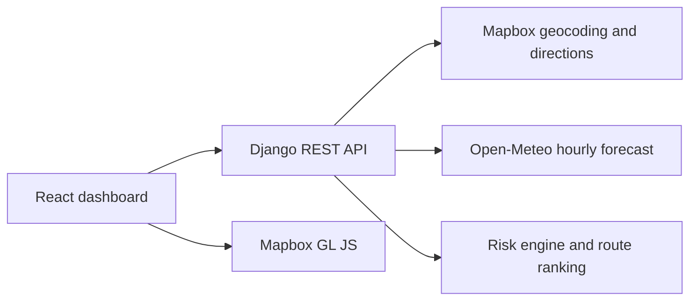

# Weather-Aware Truck Routing

Weather-Aware Truck Routing is a full-stack trip planning dashboard for comparing Mapbox driving alternatives against hourly weather forecasts. It samples the actual route geometry, applies load-sensitive wind rules, and ranks routes using the assessment's deterministic safety priorities.

## Implemented assessment requirements

- React/Vite/Tailwind responsive dashboard with route comparison, weather details, loading and error states.
- Django REST API under `/api/v1/routes/analyze/` and `/health/`.
- Mapbox geocoding, driving alternatives, route geometry, and Mapbox map rendering.
- Open-Meteo hourly wind, precipitation, and snowfall values matched to estimated checkpoint arrival.
- Open-Meteo `rain` and `precipitation` are requested in millimeters and `snowfall` in centimeters, then converted to inches/hour before risk evaluation. Total precipitation remains separate from liquid rain.
- Real Mapbox weather-risk heat corridor synchronized to the 0–48 hour Open-Meteo forecast slider.
- Lazy-loaded Mapbox route module to keep the initial frontend bundle smaller.
- Route-analysis throttling, provider timing logs, production logging, and explicit unavailable-heatmap feedback.
- 10/25/50-mile geometry-based checkpoint sampling.
- Exact wind, rain, snow, and load-dependent risk thresholds.
- Segment risk miles, coverage, average score, No Travel safety gate, and lexicographic recommendation.
- Automated risk-engine tests without live API dependencies.

## Architecture



## Prerequisites and local setup

- Python 3.12+
- Node.js 18+
- Mapbox public/access token with Geocoding and Directions access

```powershell
cd backend
python -m venv .venv
.venv\Scripts\Activate.ps1
pip install -r requirements.txt
Copy-Item .env.example .env
python manage.py runserver
```

In another terminal:

```powershell
cd frontend
npm install
Copy-Item .env.example .env
npm run dev
```

Set the Mapbox secret token only in `backend/.env`. Set the restricted public token in `frontend/.env`. The backend token is never sent to the browser. Open-Meteo does not require an API key.

Use `backend/.env` for private backend configuration and `frontend/.env` for frontend configuration. Both files are ignored by Git.

Mapbox requires visible attribution in map experiences; Mapbox GL JS supplies the attribution control used by this application. Review Mapbox account terms, token URL restrictions, Directions/Geocoding quotas, and Open-Meteo usage guidance before production deployment.

### Credentials required

You need:

1. **Mapbox secret access token** for the backend:
   - Used by Geocoding and Directions APIs.
   - Configure as `MAPBOX_ACCESS_TOKEN`.
   - Keep this token private and never expose it in frontend code.
2. **Mapbox public token** for the frontend:
   - Used by Mapbox GL JS to render the map.
   - Configure as `VITE_MAPBOX_PUBLIC_TOKEN`.
   - Restrict it to the frontend domain in Mapbox token settings.
3. **Django secret key**:
   - Generate a long random value and configure as `SECRET_KEY`.
   - This is local application configuration, not an external API credential.

Open-Meteo is the configured weather provider and does not require an API key.

## API

`POST /api/v1/routes/analyze/`

```json
{
  "origin": "Denver, CO",
  "destination": "Salt Lake City, UT",
  "departure_date": "2026-12-10",
  "departure_time": "08:00",
  "load_weight": 40000,
  "checkpoint_interval": 25
}
```

The response contains only the route alternatives actually returned by Mapbox (up to three), route geometry, checkpoint weather/risk details, segment risk miles, coverage, and `recommended_route_id`.

## Risk and recommendation methodology

Wind thresholds are `<25` Low, `25-<35` Moderate, `35-<45` High, `45-<55` Severe, and `>=55` No Travel. A load above 30,000 lb changes 45-<55 mph to No Travel; a load above 40,000 lb changes 35-<45 mph to Severe. Rain thresholds are `<0.10`, `0.10-<0.25`, `0.25-<0.50`, `0.50-1.00`, and `>1.00` inches/hour. Snow thresholds are `<0.5`, `0.5-<1.0`, `1.0-<2.0`, `2.0-3.0`, and `>3.0` inches/hour.

Risk score is Low=1 through No Travel=5. Each segment receives its start checkpoint's category; the final segment is not counted beyond the destination. Routes are compared by severe miles, high-risk miles, average score, then duration. No Travel and incomplete routes are excluded from the fully assessed eligible set when possible. Missing measurements remain Unknown and reduce coverage.

## Tests and production builds

```powershell
cd backend
pytest
cd ..\frontend
npm run build
```

The backend suite includes threshold boundary, geometry interpolation, invalid-input, provider-failure, and successful mocked API tests. No automated test depends on live Mapbox or Open-Meteo availability.

## GitHub publishing

Create a repository, add the remote, review the diff for secrets, and push the branch. Do not commit either `.env` file, `node_modules`, `dist`, SQLite files, or provider tokens:

```powershell
git init
git add .
git commit -m "Build weather-aware truck routing platform"
git branch -M main
git remote add origin https://github.com/<account>/<repository>.git
git push -u origin main
```

## Troubleshooting

- **Map configuration message:** set `VITE_MAPBOX_PUBLIC_TOKEN` in `frontend/.env` and restart Vite.
- **Grey or blank map:** a placeholder such as `your_public_mapbox_token` is rejected before Mapbox initialization. Use a valid restricted public token, restart Vite, and check the browser console for style or tile errors.
- **Provider configuration error:** set `MAPBOX_ACCESS_TOKEN` in `backend/.env` and restart Django.
- **CORS error:** set `FRONTEND_URL` to the exact frontend origin, including its scheme and port.
- **No safe recommendation:** inspect No Travel flags and weather coverage; the application intentionally does not call an uncertain route safe.
- **No route alternatives:** Mapbox may return fewer alternatives for a particular corridor; the UI displays only real returned routes.

## Deployment checklist

1. Deploy the backend using [render.yaml](./render.yaml) or an equivalent Python service.
2. Configure backend secrets and `DEBUG=False`.
3. Verify `/health/` on the deployed backend.
4. Set `VITE_API_BASE_URL` to the deployed `/api/v1` URL.
5. Set the public Mapbox token in Vercel with appropriate URL restrictions.
6. Build and open the deployed frontend, then run one real trip using configured provider credentials.

## Deployment

Build the frontend with `npm run build` and deploy `frontend/dist` to Vercel with `VITE_API_BASE_URL` and `VITE_MAPBOX_PUBLIC_TOKEN`. Deploy Django to Render or another Python host with `gunicorn config.wsgi:application`, `DEBUG=False`, a generated `SECRET_KEY`, `ALLOWED_HOSTS`, `FRONTEND_URL`, and `MAPBOX_ACCESS_TOKEN`. Do not commit `.env` files or tokens.

## Known limitations

- Mapbox's returned alternatives depend on provider availability; the application never fabricates routes.
- Route duration is provider duration and is not a live traffic prediction.
- The forecast is nearest-hour data from Open-Meteo and is limited by its available horizon.
- Open-Meteo rain and snowfall may legitimately be zero at every checkpoint during a dry forecast. Missing or out-of-range values are shown as unavailable, never converted to zero.
- The heat corridor uses one batched Open-Meteo multi-coordinate request per returned route. Samples are placed on the actual route geometry at no more than 25-mile spacing, and only provider-returned hourly values are rendered. Missing/out-of-range samples are omitted from the heat layer and remain visible as unavailable in the checkpoint data.
- Anonymous route analysis is throttled by `ROUTE_ANALYSIS_RATE` (default `10/min`). Provider timing logs include operation and duration only; credentials and request URLs are not logged.
- The current deployment configuration intentionally avoids Docker, queues, authentication, and persistent trip storage because they are not required for this assessment.
