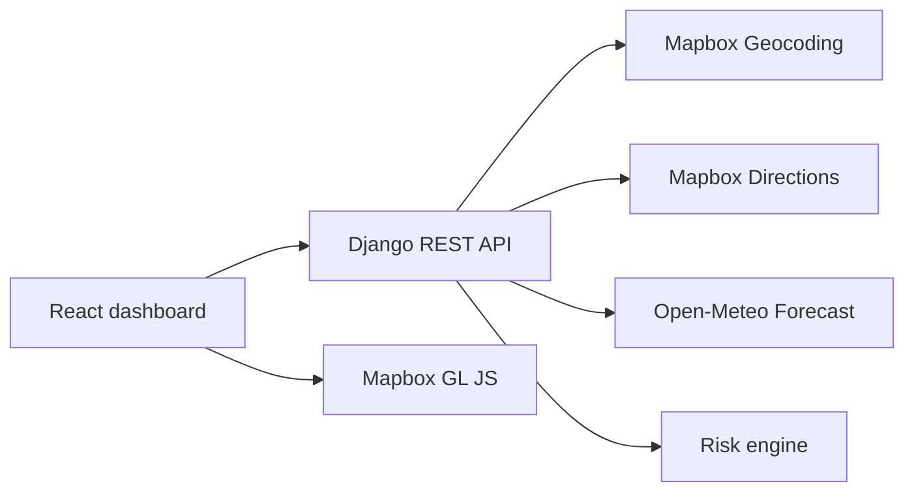

# Weather-Aware Truck Routing

Weather-Aware Truck Routing is a full-stack React and Django application that helps dispatchers compare driving routes using route geometry, truck load, travel time, and hourly weather forecasts.

The application:

- Geocodes origin and destination locations with Mapbox.
- Retrieves up to three real driving alternatives from Mapbox Directions.
- Samples every route at a configurable 10, 25, or 50-mile interval.
- Estimates the truck's arrival time at every checkpoint.
- Retrieves weather for each checkpoint at its estimated arrival time.
- Converts provider measurements into the units used by the risk rules.
- Classifies wind, rain, and snow conditions using the Spotter assessment thresholds.
- Ranks routes by severe-risk miles, high-risk miles, average risk, and travel time.
- Displays route lines, endpoints, checkpoints, weather popups, and a synchronized weather-risk heatmap.

## Application overview

The dashboard contains:

- A full-width trip planner with origin, destination, departure date/time, load weight, and checkpoint interval.
- Route comparison cards with recommendation status, distance, duration, ETA, coverage, risk miles, and average risk.
- An interactive Mapbox map with route alternatives, origin/destination markers, checkpoint markers, and route selection.
- A weather checkpoint table containing temperature, wind, rain, total precipitation, snow, ETA, and risk.
- A weather-risk corridor heatmap based on real Open-Meteo forecast values sampled along the selected route.
- A 0–48-hour forecast slider that updates the displayed corridor forecast.
- Loading, empty, provider-error, invalid-input, retry, and unavailable-weather states.
- Responsive layouts for desktop, tablet, and mobile screens.

## Technology

### Frontend

- React 18
- Vite
- Tailwind CSS
- Mapbox GL JS
- Axios
- Lucide React
- Vitest

### Backend

- Python 3.12+
- Django 5.2
- Django REST Framework
- Requests
- Gunicorn
- Pytest and pytest-django

### External services

- Mapbox Geocoding API
- Mapbox Directions API
- Mapbox GL JS map tiles
- Open-Meteo hourly forecast API

Open-Meteo does not require an API key.

## Architecture



The backend owns route generation, checkpoint sampling, forecast retrieval, unit conversion, risk classification, and recommendation ranking. The frontend renders the response and never calculates or fabricates route/weather values.

## Project structure

```text
.
├── backend/
│   ├── config/
│   │   ├── settings.py
│   │   ├── urls.py
│   │   └── wsgi.py
│   ├── routing/
│   │   ├── risk_engine.py
│   │   ├── serializers.py
│   │   ├── views.py
│   │   ├── services/
│   │   │   ├── geometry.py
│   │   │   ├── mapbox.py
│   │   │   └── open_meteo.py
│   │   └── tests/
│   ├── .env.example
│   └── requirements.txt
├── frontend/
│   ├── src/
│   │   ├── components/
│   │   ├── services/
│   │   ├── utils/
│   │   ├── App.jsx
│   │   └── main.jsx
│   ├── .env.example
│   └── package.json
├── docs/
├── render.yaml
└── README.md
```

## Local setup

### 1. Backend

From the repository root:

```powershell
cd backend
python -m venv .venv
.venv\Scripts\Activate.ps1
pip install -r requirements.txt
Copy-Item .env.example .env
```

Edit `backend/.env` and set the backend configuration:

```env
DEBUG=True
SECRET_KEY=replace_with_a_secure_random_secret
ALLOWED_HOSTS=127.0.0.1,localhost
FRONTEND_URL=http://localhost:5173
MAPBOX_ACCESS_TOKEN=your_server_mapbox_token
WEATHER_PROVIDER=open_meteo
ROUTE_ANALYSIS_RATE=10/min
LOG_LEVEL=INFO
```

Start Django:

```powershell
python manage.py runserver
```

The backend runs at `http://127.0.0.1:8000`.

### 2. Frontend

Open another terminal:

```powershell
cd frontend
npm install
Copy-Item .env.example .env
```

Edit `frontend/.env`:

```env
VITE_API_BASE_URL=http://127.0.0.1:8000/api/v1
VITE_MAPBOX_PUBLIC_TOKEN=your_restricted_public_mapbox_token
```

Start Vite:

```powershell
npm run dev
```

The frontend runs at `http://localhost:5173`.

Use separate Mapbox tokens:

- `MAPBOX_ACCESS_TOKEN` is private and stays in the backend.
- `VITE_MAPBOX_PUBLIC_TOKEN` is a browser token restricted to the frontend domains.

Both `.env` files are ignored by Git.

## API

### Health check

```http
GET /health/
```

Example response:

```json
{
  "status": "ok"
}
```

### Analyze a trip

```http
POST /api/v1/routes/analyze/
Content-Type: application/json
```

Request:

```json
{
  "origin": "Delhi",
  "destination": "Jaipur",
  "departure_date": "2026-10-23",
  "departure_time": "08:00",
  "load_weight": 40000,
  "checkpoint_interval": 25
}
```

The response includes:

- Geocoded origin and destination
- Real Mapbox route alternatives
- GeoJSON route geometry
- Route distance and provider duration
- Estimated arrival time
- Checkpoint coordinates and ETAs
- Weather values and forecast timestamps
- Checkpoint risk classifications
- Severe, high, moderate, and No Travel miles
- Weather coverage percentage
- Average risk score
- Recommendation and ranking explanation
- Route-aligned weather corridor samples

## Weather corridor heatmap

The heatmap is a risk-score visualization based on real forecast data.

### Backend flow

1. The selected Mapbox route geometry is sampled at no more than 25-mile spacing.
2. The backend sends the sampled route coordinates to Open-Meteo in a batched multi-coordinate request.
3. Open-Meteo returns hourly values for:
   - `rain`
   - `precipitation`
   - `snowfall`
   - `temperature_2m`
   - `wind_speed_10m`
4. The backend matches each requested forecast hour to the provider timestamp.
5. Rain and total precipitation are converted from millimeters to inches per hour.
6. Snowfall is converted from centimeters to inches per hour.
7. The load-sensitive risk engine calculates a score from 1 through 5.
8. Missing or out-of-range measurements remain unavailable.

### Frontend flow

The frontend uses the selected route's corridor samples as GeoJSON points and renders them with a Mapbox heatmap layer. Moving the forecast slider selects the nearest actual provider timestamp and refreshes the heatmap. Selecting another route replaces the corridor source and redraws the layer for that route.

Heatmap colors represent:

| Color | Risk |
|---|---|
| Green | Low |
| Yellow | Moderate |
| Orange | High |
| Red | Severe |
| Dark red | No Travel |

Unavailable samples are omitted from the heat layer and are reported in the map and weather UI. They are never treated as zero or safe conditions.

## Risk rules

### Wind

| Wind speed | Risk |
|---:|---|
| `< 25 mph` | Low |
| `25–<35 mph` | Moderate |
| `35–<45 mph` | High |
| `45–<55 mph` | Severe |
| `>=55 mph` | No Travel |

Load rules:

- Wind `>=45 mph` with load above `30,000 lb` becomes No Travel.
- Wind `35–<45 mph` with load above `40,000 lb` becomes Severe.

### Rain

| Rain intensity | Risk |
|---:|---|
| `<0.10 in/hr` | Low |
| `0.10–<0.25 in/hr` | Moderate |
| `0.25–<0.50 in/hr` | High |
| `0.50–1.00 in/hr` | Severe |
| `>1.00 in/hr` | No Travel |

### Snow

| Snowfall intensity | Risk |
|---:|---|
| `<0.5 in/hr` | Low |
| `0.5–<1.0 in/hr` | Moderate |
| `1.0–<2.0 in/hr` | High |
| `2.0–3.0 in/hr` | Severe |
| `>3.0 in/hr` | No Travel |

Missing hazard values produce `Unknown` for that hazard and reduce weather coverage. A route with incomplete weather is not treated as a fully assessed safe recommendation.

## Recommendation logic

Routes are ranked in this order:

1. Fewest severe-risk miles
2. Fewest high-risk miles
3. Lowest average risk score
4. Shortest provider travel duration

The recommendation is qualified only when the route has complete weather assessment and no No Travel checkpoints. If no route meets those conditions, the UI presents a safety review instead of calling an uncertain route safe.

## Error handling and request protection

The application handles:

- Missing or invalid Mapbox credentials
- Mapbox authorization failures
- Mapbox `NoRoute` responses
- Invalid locations
- Provider timeouts
- Provider network failures
- Invalid provider JSON
- Missing forecast values
- Forecast timestamps outside the available period
- Overlapping frontend requests
- Stale route responses

Starting a new analysis clears the previous result. Older requests cannot overwrite newer results. Anonymous route analysis is throttled by `ROUTE_ANALYSIS_RATE`, which defaults to `10/min`.

Provider logs include operation names, status codes, and elapsed time without logging access tokens.

## Testing

Run backend tests:

```powershell
cd backend
pytest
```

Run frontend tests:

```powershell
cd frontend
npm test -- --run
```

Build the frontend:

```powershell
npm run build
```

The test suites cover:

- Risk threshold boundaries
- Load-dependent wind rules
- Geometry-based checkpoint sampling
- Weather timestamp matching
- Rain and snowfall unit conversion
- Zero and missing weather values
- Forecast-window handling
- Corridor weather samples
- Mapbox provider failures
- Successful and failed route analysis
- Stale-result state transitions
- Route recommendation behavior

## Deployment

### Backend

The repository includes [render.yaml](./render.yaml) for a Render deployment. Configure these production variables:

```env
DEBUG=False
SECRET_KEY=secure_random_production_secret
ALLOWED_HOSTS=your-backend-domain
FRONTEND_URL=https://your-frontend-domain
MAPBOX_ACCESS_TOKEN=your_server_mapbox_token
ROUTE_ANALYSIS_RATE=10/min
LOG_LEVEL=INFO
```

The production server command is:

```powershell
gunicorn config.wsgi:application
```

Verify:

```text
https://your-backend-domain/health/
```

### Frontend

Build the frontend:

```powershell
cd frontend
npm run build
```

Deploy `frontend/dist` to Vercel or another static hosting provider. Configure:

```env
VITE_API_BASE_URL=https://your-backend-domain/api/v1
VITE_MAPBOX_PUBLIC_TOKEN=your_restricted_public_mapbox_token
```

Restrict the public Mapbox token to the deployed frontend domain.

## Documentation

- [API documentation](./docs/api-documentation.md)
- [Architecture](./docs/architecture.md)
- [Demo script](./docs/demo-script.md)

## Publishing safely

Before pushing to GitHub:

```powershell
git status
git diff --check
```

Do not commit:

- `backend/.env`
- `frontend/.env`
- Mapbox access tokens
- `node_modules`
- `frontend/dist`
- SQLite database files
- Python cache files

The repository's `.gitignore` is configured for these local and generated files.
